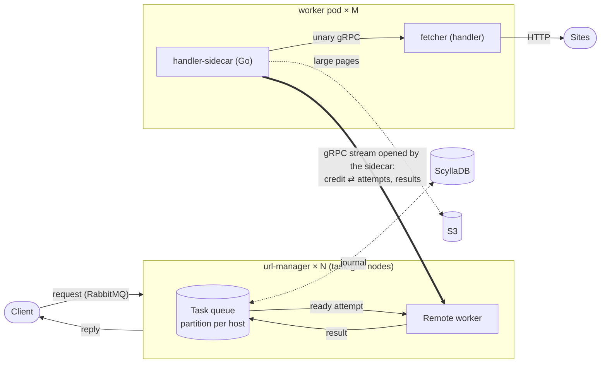
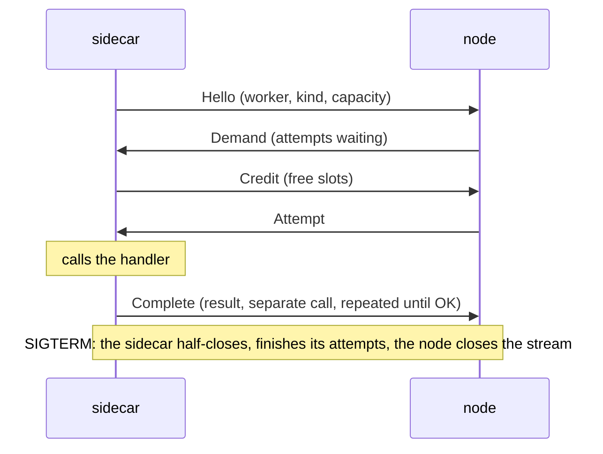

# task-grid

A pet project: run tasks on a pool of remote workers. The workers do not expose any API for receiving work: they
connect to the task nodes themselves (a reverse gRPC connection) and take tasks as they have free capacity. A web
crawler is built on top as the example: the worker is `fetcher`, which downloads a page.

What the project tries out:

- a **reliable task queue** that keeps order and pauses per key (crawl-delay of a host) across a cluster and
  survives a node restart;
- **remote workers over a reverse gRPC connection**: any process with one gRPC method becomes a worker by putting a
  sidecar next to it; capacity, retries, reconnects and graceful shutdown are handled by the sidecar and the node.

## The picture



The sidecar connects to every node (one DNS name of all of them) and shares its slots among them; nodes never call
workers. A pool scales by adding pods; the nodes export its load (`waiting`, `busy`, `capacity`) for an autoscaler.

## Key parts

**Reliable queue** - `libs/task-grid-queue-pekko`. A partition of the queue (all tasks of one key, e.g. a host) is a
sharded event-sourced entity of a Pekko cluster with its journal in ScyllaDB: tasks of a key run one at a time with a
pause between them, wherever the partition lives. A node stops - its partitions move to other nodes and continue from
the journal; a result is acknowledged only once it is in the journal. An in-memory queue with the same logic exists
for a single process.

**Remote worker + sidecar** - `libs/task-grid-worker-remote` (the node side) and `handler-sidecar` (Go). One gRPC
stream per sidecar and node, opened by the sidecar:



The node sends an attempt only against the credit of the sidecar, so a worker is never overloaded. Attempts belong
to the sidecar process, not to a connection: a reconnect keeps them, a lost worker's attempts go to other workers.
Tasks with the same affinity key prefer the same worker. Large results go to S3 and travel as references.

Everything else - url-manager as the client API (RabbitMQ, REST), fetcher, the docker-compose stand - is the example
around these two parts.

## Layout

```
libs/task-grid-core           domain, ports (queue, worker), in-memory queue, dispatcher
libs/task-grid-queue-pekko    persistent queue on Pekko Cluster Sharding + Persistence
libs/task-grid-worker-remote  remote worker: protocol (remote.proto), credit, affinity, gRPC service
libs/task-grid-gateway-grpc   clients over gRPC: submit, a stream of results of their box, ack
libs/task-grid-gateway-amqp   clients over RabbitMQ: request messages, replies to reply_to
libs/task-grid-mailbox-pekko  the boxes of the results in the Pekko cluster (task-grid-pekko-core - shared serialization)
handler-sidecar/              Go sidecar next to a handler
crawler-example/              the crawler: url-manager, fetcher, docker-compose stand
docs/                         roadmap, decisions, concepts, structure
```

## Try it

```
make verify                        # build, unit tests, architecture rules (Java 25, Go)
make it                            # integration tests (Docker)
make stand PROFILE=cluster         # docker-compose stand: 3 nodes, ScyllaDB, RabbitMQ, workers; or PROFILE=memory
```

More: [concepts](docs/concepts.md), [decisions](docs/decisions.md), [roadmap](docs/roadmap.md),
[structure](docs/structure.md), [sidecar](handler-sidecar/README.md), [stand](crawler-example/stand/README.md).
